# Agileday userscripts

[Tampermonkey](https://www.tampermonkey.net/) userscripts that improve time reporting in
[Agileday](https://agileday.io) (`https://<organisation>.agileday.io`).

- The scripts only change the page in your own browser. They work through Agileday's
  own user interface: they read what is on the page and, where a feature needs it,
  type into fields, click buttons and set the date range the same way you would.
- They make **no network requests** and send no data anywhere. Settings are kept in
  your browser's `localStorage` / `sessionStorage`.
- Each script is independent. Install only the ones you want.

These are unofficial scripts maintained by Alfame.
They are not part of Agileday, and Agileday support does not cover them. If a script
misbehaves, disable it in Tampermonkey and Agileday is back to normal.

> **Language note.** The few texts the scripts add to the page (button labels,
> tooltips, notices) and the code comments are in Finnish. This README gives the
> English meaning of every label you will see.

## Contents

- [Installation](#installation)
- [Scripts](#scripts)
- [Features](#features)
  - Time card: [sticky-totals](#agileday-sticky-totals) ·
    [copy-comments](#agileday-copy-comments) · [day-colors](#agileday-day-colors) ·
    [drag-clone](#agileday-drag-clone) · [accordion](#agileday-accordion) ·
    [plain-task-names](#agileday-plain-task-names)
  - My hours: [my-hours](#agileday-my-hours)
  - Anywhere: [demo-mode](#agileday-demo-mode)
- [When something stops working](#when-something-stops-working)
- [Updates](#updates)
- [License](#license)
- [Documentation](#documentation)

## Installation

1. Install the [Tampermonkey](https://www.tampermonkey.net/) browser extension.
   - In Chrome and other Chromium browsers, also turn on **Allow User Scripts** in the
     extension's details (`chrome://extensions` → Tampermonkey → Details). On older
     Chrome versions, turn on **Developer mode** on `chrome://extensions` instead.
     Without this the scripts never start.
2. Click the **install** link of a script in the table below. Tampermonkey opens an
   installation page; confirm with **Install**.
3. Reload Agileday.

## Scripts

| Script | What it does | Install |
|---|---|---|
| `agileday-sticky-totals` | Keeps the *Reported hours* summary row visible above the Submit bar while you scroll. | [install](https://raw.githubusercontent.com/alfameCom/agileday-tampermonkey-scripts/main/agileday-sticky-totals.user.js) |
| `agileday-copy-comments` | Right-click a comment bubble to copy the comment to the clipboard. | [install](https://raw.githubusercontent.com/alfameCom/agileday-tampermonkey-scripts/main/agileday-copy-comments.user.js) |
| `agileday-day-colors` | Highlights today, colours hours and flex by how full the day is, dims future days. | [install](https://raw.githubusercontent.com/alfameCom/agileday-tampermonkey-scripts/main/agileday-day-colors.user.js) |
| `agileday-drag-clone` | Alt-drag a time entry (with its comment) to another day of the same task; Alt shows a × that clears a cell. | [install](https://raw.githubusercontent.com/alfameCom/agileday-tampermonkey-scripts/main/agileday-drag-clone.user.js) |
| `agileday-accordion` | Collapsible project groups (projects without hours start closed), collapsible Submit/Agent bars, dismissible freeze notice. | [install](https://raw.githubusercontent.com/alfameCom/agileday-tampermonkey-scripts/main/agileday-accordion.user.js) |
| `agileday-plain-task-names` | Task rows with hours this week show the task name as plain text instead of a dropdown. | [install](https://raw.githubusercontent.com/alfameCom/agileday-tampermonkey-scripts/main/agileday-plain-task-names.user.js) |
| `agileday-my-hours` | *My hours* tab: quick date ranges, expand/collapse all, custom grouping with sorting and filters, persistent column widths, column hiding and ordering. | [install](https://raw.githubusercontent.com/alfameCom/agileday-tampermonkey-scripts/main/agileday-my-hours.user.js) |
| `agileday-demo-mode` | Replaces names, customers, projects, tasks and descriptions with generic ones for screen recordings (Ctrl+Alt+D). | [install](https://raw.githubusercontent.com/alfameCom/agileday-tampermonkey-scripts/main/agileday-demo-mode.user.js) |

All scripts except `agileday-demo-mode` load the shared helper
[`lib/pj-health.js`](lib/pj-health.js), which warns you when Agileday's page has changed
so that a script no longer works. See [When something stops working](#when-something-stops-working).

## Features

### agileday-sticky-totals

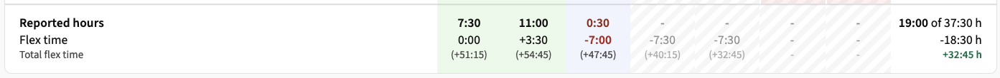

- On the time card (`/hours`), the bottom row of the table (**Reported hours**,
  **Flex time**, **Total flex time**) stays visible while you scroll, just like the
  Submit bar below it.
- The row sits right above the Submit bar. The bar's height is measured from the page
  and followed if the bar changes size.
- Works across week and month changes without reloading the page.

### agileday-copy-comments

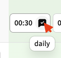

- Right-click the filled comment bubble of a time cell to copy the comment to the
  clipboard. A toast at the top of the screen shows the copied text
  (*Kopioitu leikepöydälle* = "Copied to clipboard").
- Also works in the previous month's cells, which cannot otherwise be clicked.
- Empty bubbles and the rest of the cell behave normally, so the browser's context
  menu and pasting into the hours field still work.

### agileday-day-colors

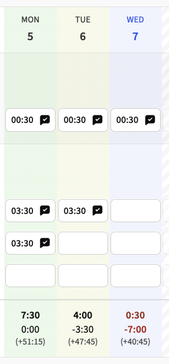

On the time card (`/hours`):

- **Today:** the whole column gets a light blue tint, and the day header is blue and bold.
- **Today's Reported hours** is coloured on a red-to-green scale by how much of the
  day's target is reported: `-` is red, a full day (7:30) is green.
  **Flex time:** negative is red (balance goes down), positive green, 0:00 default.
- **Past weekdays:** the whole column gets the same scale as a faint background. A full
  day is light green, a short one yellowish or reddish. Text is not coloured.
- The day's target is calculated as *Reported − Flex*, so shortened days are handled
  correctly. Weekends and other days whose Flex time is `-` are not coloured.
- **Future days** are dimmed and striped, and their values are not coloured. You can
  still type in them: a cell returns to normal under the mouse and while you type.
- Day columns are found from the summary row's `data-testid="total-YYYY-MM-DD"` cells,
  so this also works after changing the week. The highlight moves to the next day even
  if the page stays open overnight.

### agileday-drag-clone

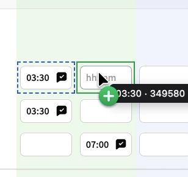

- Hold **Alt** and drag a filled time cell to another cell of the **same task**. The
  hours are copied, and so is the comment, if the source has one.
- While Alt is held, the cells that can be copied (filled cells) get a dashed blue
  outline and tint, and the cursor over them is a grab hand. While dragging, the cursor
  is a copy cursor.
- While dragging, the source cell has a dashed blue outline, the target a green frame,
  and the value being copied follows the pointer. **Esc** cancels.
- The target's old hours are replaced. If the source has no comment, the target keeps
  its own comment.
- The comment is written through Agileday's own comment dialog: the script first enters
  the hours (a comment can only be added after them), then opens the bubble, fills in
  the text and presses the save button.
- While Alt is held, filled cells show a red **×** in the top-right corner
  (*Tyhjennä solu* = "Clear cell"). One click clears the cell's hours. A toast shows the
  removed value and comment (*Tyhjennetty …* = "Cleared …") so that an accidental clear
  can be typed back.
- Locked cells (e.g. the previous month) cannot be drag targets, but they can be sources.

### agileday-accordion

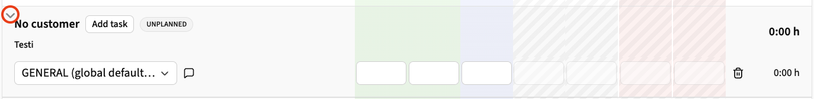

**Project groups.** Clicking a project's header row opens or closes its task rows. An
arrow in the header row's top-left corner shows the state.

- Projects without hours in the week start closed.
- A project or task you add (*Add project*, *Add task*) opens automatically.
- Your choice is kept until the page is reloaded. Each week has its own state.
- Buttons in the header row, such as *Add task*, work normally.

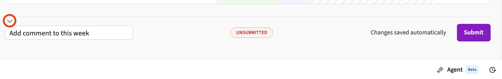

**Footer bars.** The Submit bar (week comment and Submit) and the Agent bar below it
form one accordion. When the week has no **UNSUBMITTED** status, both shrink to a thin
strip with the same arrow and the label *Viikon kommentti, Submit ja Agent*
("Week comment, Submit and Agent"). Clicking the strip opens the bars; the label hides
while they are open.

- The arrow opens and closes the bars.
- When UNSUBMITTED appears, the bars open by themselves.
- On other Agileday pages the Agent bar is shown normally.

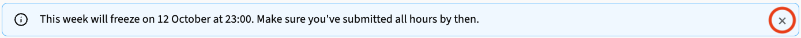

**Freeze notice.** The "This week will freeze…" notice gets a **×** on its right edge
that hides it. Hiding is temporary: reloading the page brings the notice back.

### agileday-plain-task-names

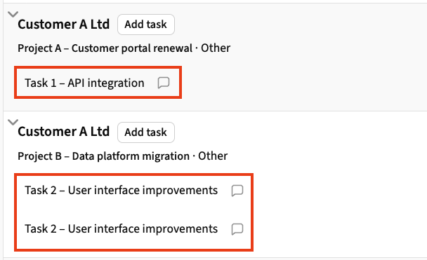

- On the time card, a task row that has hours this week shows the task name as plain
  text instead of the task dropdown. Long names wrap instead of being cut off.
- The task's *comment required* bubble sits right after the name, dimmed. It returns to
  full colour under the mouse.
- Rows without hours (for example one you just added with **Add task**) keep the
  dropdown, so you can still pick or change the task. To change the task of a row that
  has hours, clear its hours first.
- Only the view changes; no data is modified.

### agileday-my-hours

The **My hours** tab of Time reporting (`/hours?tab=hoursActuals`).

Screenshots in this section are taken in demo mode, so all names are placeholders.

**Quick date ranges.** Three buttons are added before the *Current month* button:

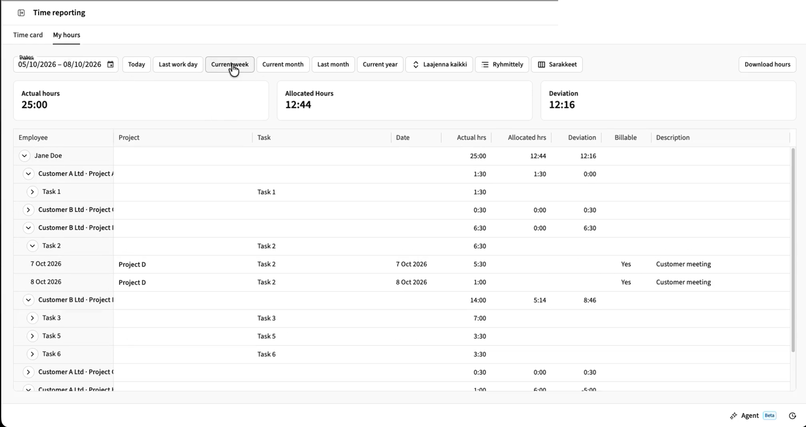

| Button | Range |
|---|---|
| Today | Today |
| Last work day | The previous weekday (on Monday: Friday). Public holidays are not taken into account. |
| Current week | From this week's Monday to today |

**Expand all / Collapse all** (*Laajenna kaikki* / *Sulje kaikki*). Opens every nested
group down to the day rows, or closes them all. The label follows whether any closed
groups are still visible.

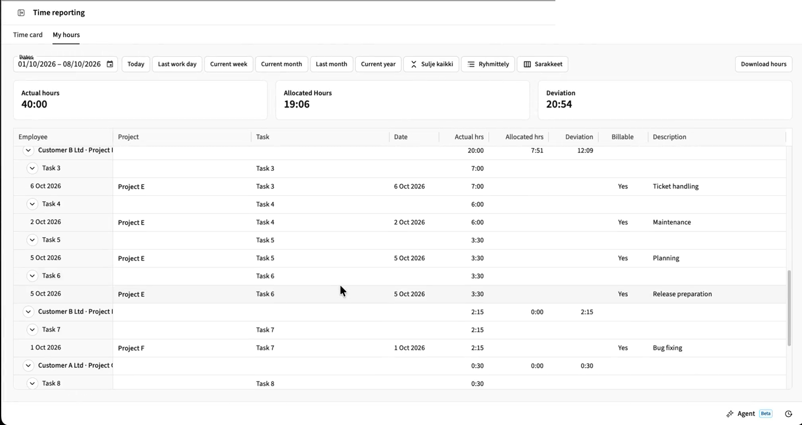

**Grouping** (*Ryhmittely*). Replaces Agileday's own grouping (person → project → task)
with one of:

| Option | Groups |
|---|---|
| *Päivä* (Day) | One group per day; the header shows the weekday ("to 1.10.2026") |
| *Projekti* (Project) | One group per project, entries in date order |
| *Projekti → Task* (Project → Task) | Tasks under each project |
| *Ei ryhmittelyä* (No grouping) | All entries in date order |
| *Agiledayn oletus* (Agileday default) | Agileday's original table |

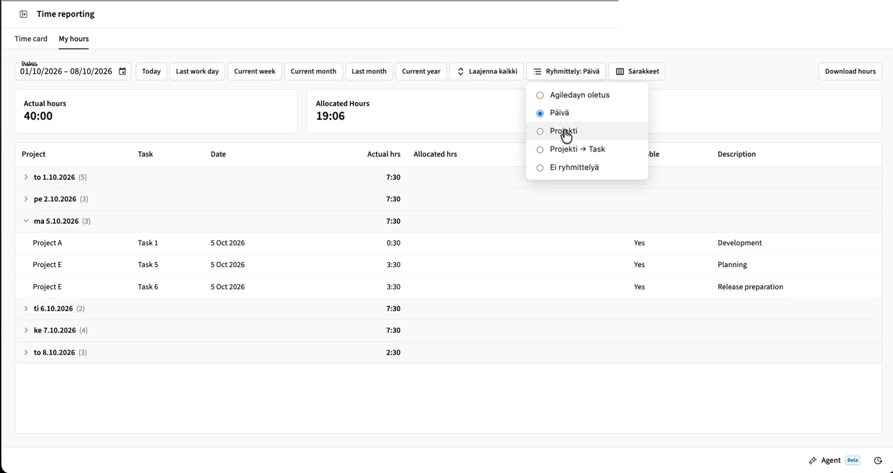

- Each group header shows the number of entries and the sum of hours under the
  *Actual hrs* column.
- Clicking a group header opens or closes it.
- The script reads the entries from Agileday's table and shows them in a table of its
  own. When the date range changes, the entries are read again.
- Clicking a column header sorts the rows within each group: ascending → descending →
  default (date). The sort order is saved.

  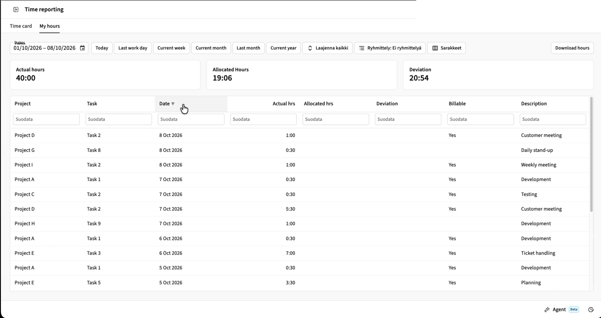
- Below the headers there is a filter field for every column. All fields must match,
  matching is case-insensitive, and group sums are calculated from the filtered rows.
  Filters are not saved.

  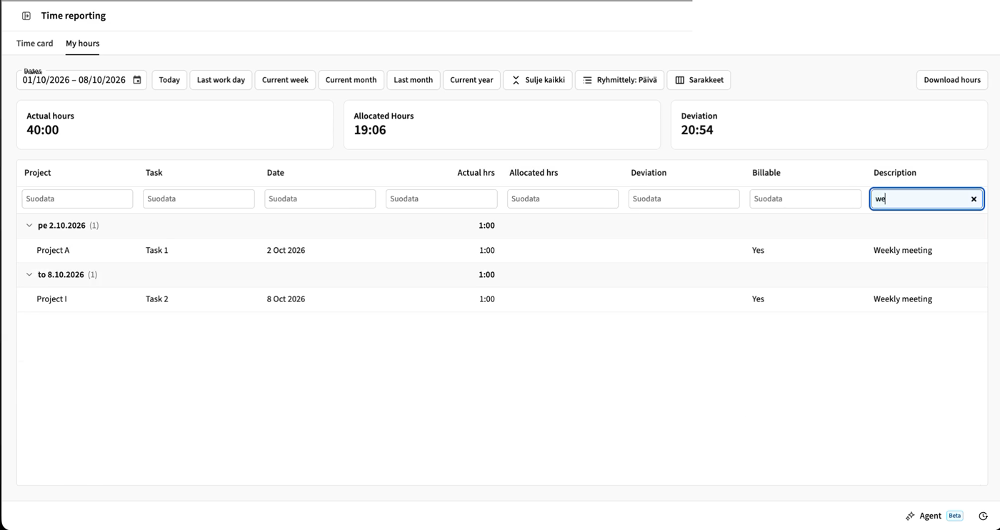

**Columns** (*Sarakkeet*). A menu with a checkbox for every column. Unchecking hides the
column, also in the custom grouping table. The *Employee* column cannot be hidden, as it
holds the group arrows. Each row's **↑/↓** moves the column left or right, in both
Agileday's table and the custom table. *Palauta oletusjärjestys* ("Restore default
order") restores Agileday's order.

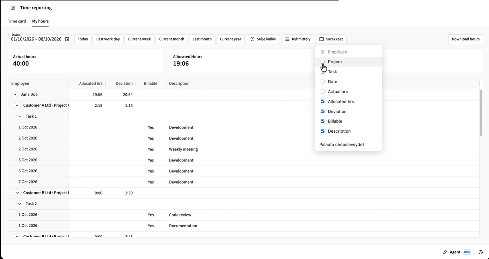

**Column widths are kept.** When you resize a column by dragging its header edge, the
width is saved and kept even when Agileday redraws the table. *Palauta oletusleveydet*
("Restore default widths") in the Columns menu forgets the saved widths and reloads the
page.

Grouping, sort order, widths, hidden columns and column order are saved in
`localStorage` and apply to all tabs.

### agileday-demo-mode

Demo mode for screen recordings and screenshots, for example when reporting an issue to
Agileday support. **Ctrl+Alt+D** toggles it, or add `#pj-demo` to the end of the URL.

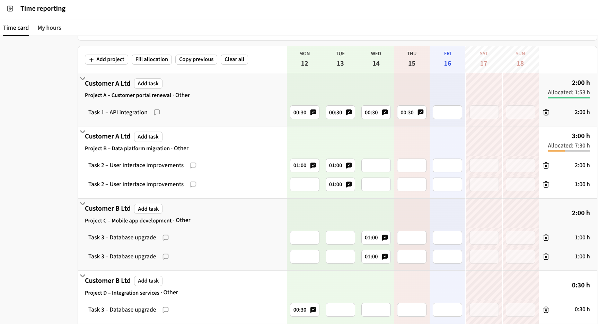

- Your name → "Jane Doe" (also in the sidebar), customers → "Customer A Ltd",
  projects → "Project A – Customer portal renewal", tasks → "Task 1 – API integration",
  descriptions → generic texts
  ("Development", "Weekly meeting", …). The profile picture is hidden.
- Hours and dates are not changed.
- The same real value always gets the same replacement, also in the custom grouping of
  `agileday-my-hours` and after reloading the page.
- Values are replaced before the browser paints, so real values do not flash in a
  recording.
- Demo mode is per browser tab. Turning it off reloads the page, which brings back the
  real values.
- Values are recognised from the *My hours* table and from the time card's project
  rows (customer and project). On other pages, only values already seen there are
  replaced.
- Time card task names are replaced when `agileday-plain-task-names` shows them as
  text. A task name inside the dropdown (a row without hours) stays real.

> Demo mode only masks what is **visible on the page**. Real data is still present in
> network responses (browser developer tools), in some tooltips and in input field
> values. Do not rely on it for anything beyond screen recordings.

## When something stops working

The scripts rely on the structure of Agileday's page, which can change with any Agileday
release. To make breakage visible instead of silent, the scripts use the shared helper
[`lib/pj-health.js`](lib/pj-health.js):

- **Structure check.** On the time card, each script checks every second that the page
  elements it needs exist. If something is still missing 10 seconds after the page has
  loaded, a yellow notice appears in the top-right corner
  (*⚠ Agileday-skripti ei toimi odotetusti* = "An Agileday script is not working as
  expected"). It names the script and the missing part, for example
  `agileday-day-colors: ei löydä: päiväsarakkeet (…)` ("cannot find: day columns").
- **Runtime errors.** Exceptions in the scripts' update functions and event handlers are
  shown in the same notice (*virhe kohdassa …* = "error in …").
- The notice disappears by itself when the check passes again. **×** hides the current
  problems for this tab; new problems still appear.
- No checks run on the day view, the *My hours* tab (except `agileday-my-hours`'s own
  checks) or an empty week, to avoid false alarms.
- **Test mode:** add `#pj-health-test` to the URL and reload. Every installed script
  that uses the helper shows a test line in the notice, which confirms it is running.

The rest of Agileday keeps working normally. Please
[open an issue](https://github.com/alfameCom/agileday-tampermonkey-scripts/issues) with the
notice text, or disable the affected script in Tampermonkey until it is fixed.

## Updates

Tampermonkey checks for updates automatically, by default once a day. To update right
away, use **Dashboard → Check for userscript updates** in Tampermonkey.

## License

[MIT](LICENSE)

## Documentation

- [docs/DEVELOPMENT.md](docs/DEVELOPMENT.md): how the scripts are built, conventions,
  testing and releasing. For contributors.
- [AGENTS.md](AGENTS.md): instructions for AI coding agents working on the scripts.
- [docs/AGILEDAY-DOM.md](docs/AGILEDAY-DOM.md): every part of Agileday's page each script
  depends on. For Agileday's developers: what to keep in mind when changing these parts,
  and which UX gaps the scripts fill.
